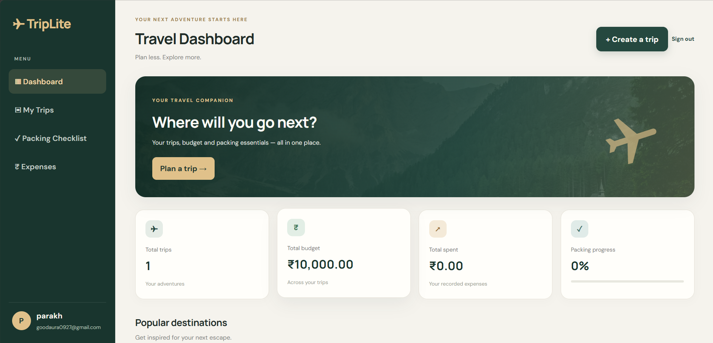
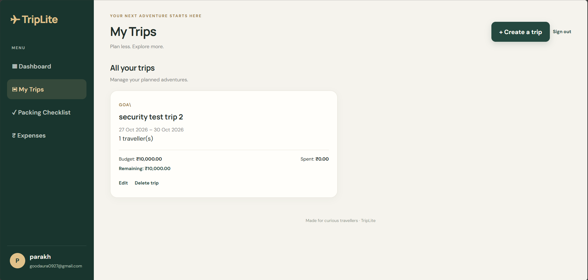
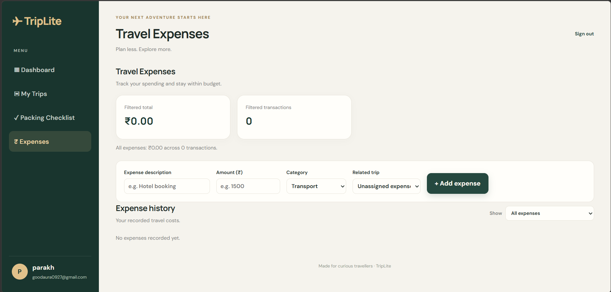
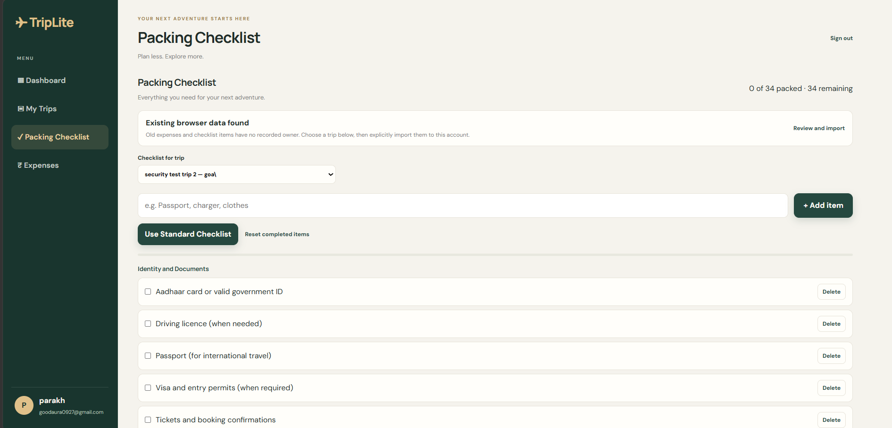

# TripLite

**Plan trips, manage travel budgets, and keep trip checklists in one lightweight web app.**

TripLite is a browser-based travel planner with account-backed trips and browser-local expenses and packing lists. It helps travelers organize trip details and compare planned budgets with recorded expenses without requiring a separate frontend build step.

> The application currently runs locally. No deployment URL or license file is included in this repository.

## Application Preview

The screenshots below show the current TripLite interface.

### Dashboard

*The dashboard summarizes trips, budgets, expenses, and packing progress.*

### My Trips

*Browse and manage trips associated with the signed-in account.*

### Expenses

*Record browser-local expenses and filter them by trip or assignment.*

### Packing Checklist

*Organize checklist items for the selected trip.*
## Contents

- [Application Preview](#application-preview)
- [Features](#features)
- [Technology stack](#technology-stack)
- [Architecture](#architecture)
- [Application and authentication flow](#application-and-authentication-flow)
- [Security](#security)
- [Project structure](#project-structure)
- [Getting started](#getting-started)
- [Environment variables](#environment-variables)
- [Run the application](#run-the-application)
- [Tests](#tests)
- [Manual verification](#manual-verification)
- [Data storage](#data-storage)
- [API reference](#api-reference)
- [Legacy trip ownership](#legacy-trip-ownership)
- [Troubleshooting](#troubleshooting)
- [Limitations and proposed improvements](#limitations-and-proposed-improvements)
- [Screenshots](#screenshots)
- [Deployment](#deployment)
- [Contributing](#contributing)
- [License](#license)
- [Project link](#project-link)

## Features

### Trips and dashboard

- Create, view, edit, and delete trips.
- Track destination, dates, traveler count, and budget.
- View trip counts, budget summaries, recorded expenses, and packing progress.
- Associate browser-local expenses with a trip and view remaining or exceeded budget totals.

### Packing and expenses

- Keep a separate packing checklist for each trip; use standard checklist items and add, check off, or remove items.
- Record expenses, optionally associate them with a trip, filter by trip or assignment, and remove entries.
- Review and explicitly import older browser-local expense and checklist data once in a browser profile.

### Accounts

- Register and sign in with an email address and password.
- View and modify only trips owned by the signed-in account.
- Keep browser-local expenses separated by account and packing items by account and trip.

## Technology stack

| Area | Technology | Use |
| --- | --- | --- |
| Frontend | HTML, CSS, vanilla JavaScript | Single-page interface served as static files by Express |
| Backend | Node.js, Express | Static hosting and JSON API |
| Database | MongoDB | User accounts, trips, and server sessions |
| ODM | Mongoose | MongoDB schemas, validation, and queries |
| Authentication | bcryptjs, express-session, connect-mongo | Password hashing and MongoDB-backed sessions |
| Request protection | express-rate-limit, built-in crypto | Authentication throttling and CSRF token comparison |
| Testing | Node.js node:test, node:assert/strict | Authentication and trip-ownership integration tests |

## Architecture

~~~mermaid
flowchart LR
    Browser[Browser: HTML, CSS, JavaScript]
    Express[Express server and JSON API]
    Mongo[(MongoDB)]
    Browser -->|Static page and same-origin API requests| Express
    Express -->|Users, trips, sessions| Mongo
    Browser -->|Expenses and packing lists| LocalStorage[(Browser localStorage)]
~~~

The browser calls the same-origin API using fetch and sends the session cookie automatically. Express serves client/, parses JSON requests, applies session and route middleware, and uses Mongoose to read or write user and trip documents. The session store uses the same MongoDB connection. Expenses and packing lists are read and written in the browser and are not sent to the API.

## Application and authentication flow

1. Express connects to MongoDB and initializes the user and trip models before listening on the configured port.
2. The browser loads the static application, requests a CSRF token, and checks the current session with GET /api/auth/me.
3. Registration or login validates submitted details; passwords are compared or hashed with bcryptjs. Successful authentication regenerates the session ID and issues a fresh CSRF token.
4. The browser keeps the CSRF token in memory and sends it with state-changing requests. The session identifier is held in a cookie; session data stays in MongoDB.
5. Protected trip routes derive the account identity from the session. Create, read, update, and delete queries include that account as the trip owner.
6. The browser loads account-scoped expense data and account-and-trip-scoped packing data from localStorage.

## Security

The following protections are implemented in the current server and browser code:

- Passwords are hashed with bcryptjs; password hashes are excluded from normal user queries and safe profile responses.
- Login and registration regenerate the session ID. Sessions are stored in MongoDB and have a 30-minute idle lifetime and a 12-hour absolute lifetime.
- The session cookie is HttpOnly and SameSite=Lax; it is marked Secure when NODE_ENV=production.
- State-changing requests require a session-bound CSRF token. When Origin or Referer is supplied, the server checks that its origin matches the request origin.
- Authentication routes are rate limited to 10 requests per 15-minute window per limiter key using the default in-memory store.
- Trip routes require authentication and scope database queries to the session owner. An owner supplied in a create request is ignored; the owner is taken from the session.
- JSON request bodies are limited to 20 KB, API responses use Cache-Control: no-store, and Express's X-Powered-By header is disabled.

TRUST_PROXY_HOPS allows configuring Express proxy trust for a known reverse-proxy topology. Set it only to match trusted infrastructure. Production cookie security requires HTTPS; this repository does not include deployment or proxy configuration. Browser localStorage is not encrypted and is not a server-enforced security boundary.

## Project structure

~~~text
TripLite/
+-- client/
|   +-- css/style.css
|   +-- index.html
|   \-- js/app.js
+-- scripts/
|   \-- claim-legacy-trips.js
+-- server/
|   +-- models/
|   |   +-- trip.js
|   |   \-- user.js
|   +-- tests/
|   |   \-- auth.test.js
|   \-- server.js
+-- .env.example
+-- .gitignore
+-- package.json
+-- package-lock.json
+-- README.md
\-- requirements.txt
~~~

## Getting started

### Prerequisites

- Node.js 18 or newer (the test runner uses built-in fetch and node:test; Node.js 20 LTS is a suitable current baseline).
- npm.
- MongoDB running locally, or access to a MongoDB deployment you are authorized to use.
- Git to clone the repository.

### Clone and install

~~~sh
git clone https://github.com/Atuliya007/TripLite.git
cd TripLite
npm install
~~~

Create the local configuration file. PowerShell:

~~~powershell
Copy-Item .env.example .env
~~~

macOS/Linux or another POSIX shell:

~~~sh
cp .env.example .env
~~~

Edit .env locally and set a session secret. Generate a suitable value with:

~~~sh
node -e "console.log(require('crypto').randomBytes(48).toString('hex'))"
~~~

Keep .env private. .gitignore excludes .env and .env.*, while allowing .env.example to be committed.

## Environment variables

The server loads .env from the repository root through dotenv. It also reads the standard NODE_ENV variable to decide whether session cookies use the Secure flag. The test file reads MONGODB_TEST_URI to select an isolated test database.

| Variable | Required | Default / example | Purpose |
| --- | --- | --- | --- |
| PORT | No | 3000 | HTTP port used by the server. |
| MONGODB_URI | No | Local MongoDB database shown in .env.example | MongoDB connection for the application and session store. |
| SESSION_SECRET | Yes | Empty in .env.example | Session signing secret; the server requires at least 32 bytes. |
| TRUST_PROXY_HOPS | No | 0 | Number of trusted proxy hops; positive integer values configure Express proxy trust. |
| NODE_ENV | No | Unset in local development | When exactly production, session cookies are marked Secure. |
| MONGODB_TEST_URI | For integration tests | Not set in .env.example | Base URI for the disposable test database; its database name must contain test. |

.env.example contains only a local MongoDB example and safe defaults/placeholders. For tests, set MONGODB_TEST_URI in the test process or a local environment configuration; the test file derives a uniquely suffixed database name and drops that temporary database during cleanup. It sets MONGODB_URI for its server process and generates a temporary session secret. Do not use the normal development database for the test URI.

## Run the application

Start MongoDB using the instructions for your operating system and installation. The default server URI expects a local MongoDB instance. Then run the development server from the project root:

~~~sh
npm run dev
~~~

npm start runs the same server directly with Node.js. Express starts listening only after connecting to MongoDB and initializing the user and trip models. By default, open http://localhost:3000. The health endpoint is http://localhost:3000/api/health; it reports the Mongoose connection state once the server is running.

## Tests

The package test command is:

~~~sh
npm test
~~~

The integration tests in server/tests/auth.test.js require MONGODB_TEST_URI. The configured base database name must contain test; the runner adds a random suffix, uses that new database, and drops it after the suite. Without the variable, the test file reports a skipped prerequisite test. Never point this variable at the regular development database.

The test file covers authentication-required responses, password hashing and safe profile output, normalized duplicate emails, generic login failures, password policy, session ID rotation, CSRF and foreign-origin rejection, session-owner assignment, owner-scoped reads, cross-account read/edit/delete denial, legacy ownerless-trip visibility, absolute session expiry, and logout. This describes test coverage; it is not a claim that tests were run while writing this documentation.

## Manual verification

After starting MongoDB and the server, these browser workflows exercise the main interface:

1. Register an account, sign out, and sign back in.
2. Create a trip with valid dates, traveler count, and budget; then edit and delete it.
3. Add a packing item, check it off, switch to another trip, and verify each checklist stays associated with its trip.
4. Record an expense with and without a trip assignment, then try the expense filters and budget summary.
5. If the browser contains legacy triplite-expenses or triplite-packing data, review the import prompt before importing. Confirm the original legacy keys remain.
6. Open /api/health and confirm the database state is connected.

## Data storage

| Data | Storage | Notes |
| --- | --- | --- |
| User accounts | MongoDB | Includes bcrypt password hashes; responses expose only a safe profile. |
| Trips | MongoDB | Each new trip has an owner from the authenticated session. |
| Sessions | MongoDB triplite_sessions collection | Session records are server-side; browsers receive a signed session identifier cookie. |
| Expenses | Browser localStorage | Namespaced by account in the browser; not synchronized or backed up by the server. |
| Packing items | Browser localStorage | Namespaced by account and trip; not synchronized or backed up by the server. |
| Imported legacy browser records | Browser localStorage | Copied into the active account namespace once per browser profile; original legacy keys are preserved. |

## API reference

All API responses are JSON. Trip IDs are MongoDB document IDs. A valid session cookie is required for private routes. POST, PUT, and DELETE routes that change state require the session's X-CSRF-Token; the server checks a supplied Origin or Referer against the request origin.

### Authentication and health

| Method and path | Authentication | Purpose / request |
| --- | --- | --- |
| GET /api/health | None | Reports whether the MongoDB connection is connected. |
| GET /api/auth/csrf | None | Creates or returns a CSRF token in the current session. |
| POST /api/auth/register | CSRF token | JSON body: name, email, password, passwordConfirmation. Registers and signs in the user. Passwords need at least 12 characters and no more than 72 UTF-8 bytes. |
| POST /api/auth/login | CSRF token | JSON body: email, password. Signs in and rotates the session ID. |
| GET /api/auth/me | Session | Returns the current safe user profile. |
| POST /api/auth/logout | Session and CSRF token | Destroys the session and clears the cookie. |

Example registration request (use your own local test values):

~~~json
{
  "name": "Taylor Example",
  "email": "taylor@example.test",
  "password": "<at-least-12-characters>",
  "passwordConfirmation": "<same-password>"
}
~~~

### Trips

| Method and path | Authentication | Purpose / request |
| --- | --- | --- |
| GET /api/trips | Session | Lists the current user's trips, newest first; response includes count and data. |
| GET /api/trips/:id | Session | Reads a trip only if it belongs to the current user. |
| POST /api/trips | Session and CSRF token | Creates a trip. Required JSON fields: name, destination, startDate, endDate, travellers, budget. Owner is taken from the session. |
| PUT /api/trips/:id | Session and CSRF token | Applies partial updates to an owned trip. Accepted fields: name, destination, startDate, endDate, travellers, budget. |
| DELETE /api/trips/:id | Session and CSRF token | Deletes an owned trip. |

Dates are calendar dates in YYYY-MM-DD format and the end date cannot precede the start. Traveler count must be a whole number from 1 through 50; budget must be finite and at least zero. A create request example:

~~~json
{
  "name": "Coastal weekend",
  "destination": "Goa",
  "startDate": "2026-11-06",
  "endDate": "2026-11-08",
  "travellers": 2,
  "budget": 25000
}
~~~

A successful create responds with HTTP 201. A representative response shape is:

~~~json
{
  "success": true,
  "message": "Trip created successfully",
  "data": {
    "_id": "<trip-id>",
    "name": "Coastal weekend",
    "destination": "Goa",
    "startDate": "2026-11-06T00:00:00.000Z",
    "endDate": "2026-11-08T00:00:00.000Z",
    "travellers": 2,
    "budget": 25000
  }
}
~~~ User-scoped trip reads and mutations return 404 when the trip is missing or belongs to another account. Invalid trip IDs return 400; unauthenticated requests return 401; CSRF or supplied-origin failures return 403; unexpected failures return 500.

## Legacy trip ownership

Trips created before accounts may have no owner and are hidden from account queries. scripts/claim-legacy-trips.js can assign all ownerless trips in the selected database to one existing account. It performs a dry run by default:

~~~sh
node scripts/claim-legacy-trips.js --email=account@example.com
~~~

Only add --apply after reviewing the selected account and the reported count, and after backing up the intended database:

~~~sh
node scripts/claim-legacy-trips.js --email=account@example.com --apply
~~~

The script uses MONGODB_URI, requires the account to exist, and updates documents with missing or null owner fields. It does not change trips already assigned to an owner. Do not run it against a database until you have verified the URI and backup.

## Troubleshooting

### Server exits before it starts listening

The server requires MongoDB and a SESSION_SECRET of at least 32 bytes. Check that MongoDB is running and that MONGODB_URI targets the intended database. Keep connection strings and secrets in the ignored root .env file.

### The browser cannot load trips

Use the Express-served site at http://localhost:<PORT>/; opening client/index.html directly does not run the API. Check the server console and /api/health. Trip endpoints require an authenticated session.

### Login or registration returns an error

Confirm the account details, registration password length, and that the browser is using the same origin for the page and API. Authentication endpoints are rate limited; repeated attempts may be temporarily rejected.

### Integration tests are skipped or cannot connect

Set MONGODB_TEST_URI to a disposable database URI whose database name contains test. Confirm MongoDB is available. Do not set it to the development database; the runner creates and drops a uniquely named database derived from it.

### The port is already in use

Set PORT in .env to an available port and open the application using that port.

## Limitations and proposed improvements

### Current limitations

- Expenses and packing lists are local to one browser profile and are not synchronized to MongoDB or across devices.
- Authentication rate limiting uses the default in-memory store, so its request counts are not shared across multiple server instances.
- This repository does not include deployment configuration, a production build pipeline, or an automated browser/UI test suite.
- There is no LICENSE file in the repository at this time.

### Proposed future improvements

These are ideas, not implemented features:

- Persist expenses and packing lists through authenticated API routes.
- Add browser-based end-to-end tests and accessibility checks.
- Add deployment configuration, operational monitoring, and a shared rate-limit store for multi-instance hosting.
- Add real screenshots and a license after the project owner selects and supplies them.

## Deployment

No deployed URL or deployment configuration is present in the repository. The project is documented as a local application; deployment remains future work. A deployment would need HTTPS, a configured MongoDB connection, a strong private session secret, and a carefully configured trusted-proxy setting where applicable.

## Contributing

There is no separate contribution guide. For local development, create a private .env, install dependencies with npm install, and run npm run dev. Before proposing changes, run the relevant syntax checks and npm test against a disposable test database. Do not commit .env, credentials, or database exports. Keep changes focused and update this README when routes, environment variables, or workflows change.

## License

No LICENSE file is present. All rights remain with the copyright holder unless a license is added; do not assume permission to reuse or redistribute this project.

## Project link

- [TripLite on GitHub](https://github.com/Atuliya007/TripLite)
